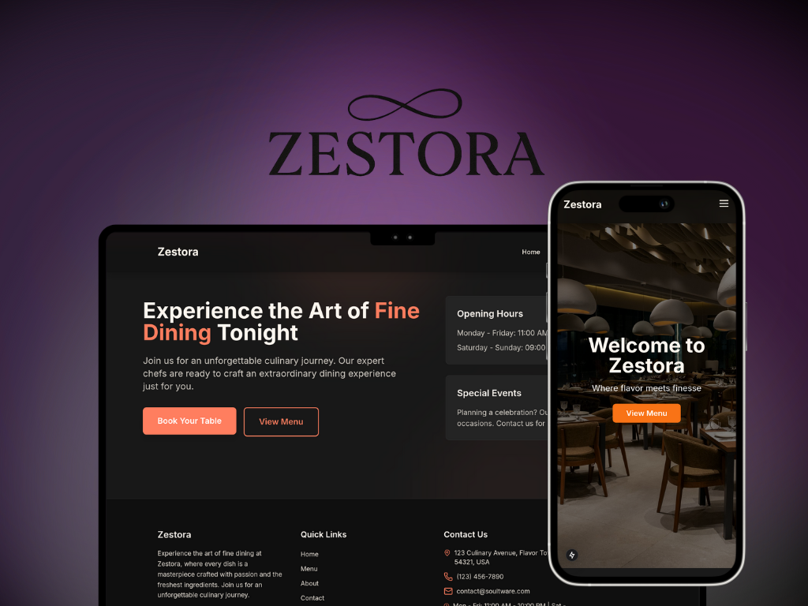

# Zestora Restaurant Website

A modern, elegant restaurant website built with Next.js 15, showcasing SOULTWARE's expertise in creating beautiful and performant web applications.




## 🌟 Features

- **Modern Design**: Sleek, responsive interface with beautiful animations and transitions
- **Performance Optimized**: Built with Next.js 15 for optimal performance and SEO
- **Interactive UI**: Smooth animations powered by Framer Motion
- **Responsive Layout**: Perfect viewing experience across all devices
- **Dark Theme**: Elegant dark mode design for enhanced visual appeal

## 🛠 Tech Stack

- **Framework**: Next.js 15 (App Router)
- **Styling**: Tailwind CSS
- **Animations**: Framer Motion
- **Language**: TypeScript
- **Form Handling**: React Hook Form with Zod validation
- **Package Manager**: pnpm

## 📱 Key Pages

- **Home**: Engaging landing page with hero section and key features
- **Menu**: Interactive menu with category filtering
- **About**: Team showcase with elegant chef cards
- **Contact**: Contact form with validation
- **Reservation**: Table booking system

## 🚀 Getting Started

1. Clone the repository:
```bash
git clone https://github.com/soultware/zestora.git
```

2. Install dependencies:
```bash
pnpm install
```

3. Run the development server:
```bash
pnpm dev
```

4. Open [http://localhost:3000](http://localhost:3000) in your browser

## 💻 Development

- **Development Mode**: `pnpm dev`
- **Build**: `pnpm build`
- **Start Production Server**: `pnpm start`
- **Type Checking**: `pnpm type-check`

## 🎨 Project Structure

```
zestora/
├── app/                # Next.js app directory
│   ├── about/         # About page
│   ├── contact/       # Contact page
│   ├── menu/          # Menu page
│   └── reservation/   # Reservation page
├── components/        # Reusable components
├── lib/              # Utilities and data
├── public/           # Static assets
└── types/            # TypeScript types
```

## ✨ About SOULTWARE

This project is a demonstration of SOULTWARE's capabilities in creating modern, performant web applications. We specialize in:

- Modern Web Development
- User Experience Design
- Performance Optimization
- Responsive Design
- Custom Solutions

Visit [SOULTWARE](https://soultware.com) to learn more about our services.

## 📄 License

This project is a demo created by SOULTWARE. All rights reserved.

---

Created with ❤️ by [SOULTWARE](https://soultware.com)
